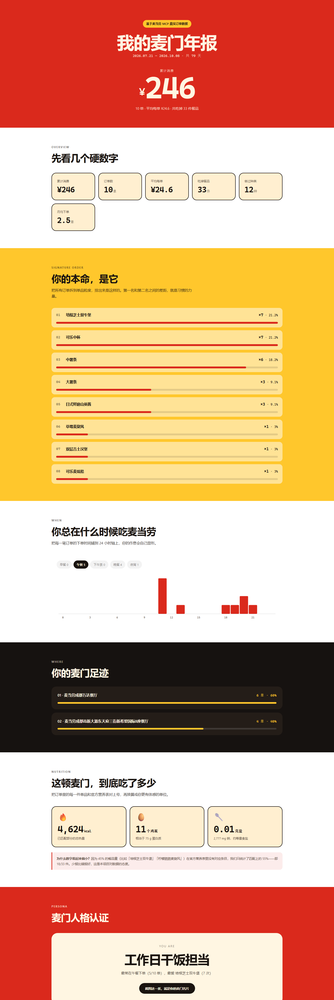

# 麦门年报 · McYearbook

> **你的麦当劳，其实一直在给你记账——只是从来没人给你看。**

基于麦当劳 MCP 返回的真实历史订单，生成一份 Wrapped 风格的麦门年报：
你的本命汉堡、你总在几点下单、你踏过哪几家门店、这顿麦门到底吃进去多少，
以及一张可以直接截图当社交名片的「麦门人格认证」。



## 它解决什么问题

打开麦当劳 App 能看到你的订单记录。但有个更有意思的问题，很少有人认真回答过：

> **在麦当劳眼里，我是个什么样的人？**

这份年报回答它。全部数字来自 MCP 真实接口，没有一个是编的。

## 页面里有什么

| 板块 | 内容 |
|---|---|
| 累计消费 | 大字号总金额 + 订单数 + 平均每单 |
| 硬数字 | 消费 / 订单 / 餐品件数 / 尝过种类 / 月均下单 |
| 本命餐品 | 拆到单品粒度的 TOP 8，带占比条 |
| 时间画像 | 24 小时下单分布柱状图 + 早餐/午餐/下午茶/晚餐/夜宵 |
| 麦门足迹 | 门店排名与占比 |
| 营养换算 | 总热量、蛋白质 ≈ 几个鸡蛋、钠 ≈ 几克盐 |
| 人格认证 | 规则可解释的麦门人格 + 判定依据，一张卡截图即分享 |

## 快速开始

```bash
git clone https://github.com/<your-name>/mcd-yearbook.git
cd mcd-yearbook

# 1. 领取免费的麦当劳 MCP Token（手机号登录，控制台点激活）
#    https://open.mcd.cn/mcp
export MCD_MCP_TOKEN="你的 Token"        # Windows: set MCD_MCP_TOKEN=...

# 2. 拉取自己的订单（仓库里已带一份脱敏的真实快照，可跳过直接看效果）
python scripts/mcd_client.py call order-list > data/orders_raw.json

# 3. 生成你的年报
python scripts/build_yearbook.py
python scripts/render_yearbook.py       # -> docs/index.html
```

打开 `docs/index.html`，或者开启 GitHub Pages（Settings → Pages → `main` 分支 `/docs`）在线看。

## 诚实声明（这部分请务必读）

**营养数字偏小，是有意的。**

订单里的很多单品在官方营养表里没有对应条目——比如「培根芝士双牛堡」「柠檬脆脆麦旋风」。
两种处理方式：

- ❌ 用相近餐品的营养值近似填充，数字好看，但是编的
- ✅ 只统计匹配成功的部分，把覆盖率明明白白写在页面上

本项目选后者。当前快照的匹配率是 **55%（19/33 件）**，页面底部有专门说明。

**「年报」其实不是全年。** 麦当劳 MCP 的 `order-list` 只返回近期订单。
页面如实标注了实际覆盖区间（示例数据为 2026.07.21 – 2026.10.08），
我们不做「把近期包装成年度」这种事。

**人格判定是规则，不是玄学。** 「工作日干饭担当」这类标签来自一组可解释的 if/else，
页面会直接展示判定依据——比如「最常在午餐下单（5/10 单），最爱 培根芝士双牛堡（7 次）」。
你能看到为什么，才愿意相信它、分享它。

## 目标用户

- **麦当劳重度用户**：想知道自己这一年到底吃了多少
- **喜欢 Wrapped 类内容的人**：Spotify 年度总结 / 支付宝年度账单的受众
- **想给自己找点乐子的开发者**：fork 下来跑一遍自己的数据，比看别人的有意思得多

## 项目结构

```
mcd-yearbook/
├── SKILL.md                      # WorkBuddy Skill 定义（本仓库根目录即 Skill 目录）
├── scripts/
│   ├── mcd_client.py             # 麦当劳 MCP 客户端（标准库，零依赖）
│   ├── build_yearbook.py         # 订单 + 营养 -> data/yearbook.json
│   └── render_yearbook.py        # 生成 docs/index.html
├── data/
│   ├── orders_raw.json           # order-list 的原始响应快照（已脱敏）
│   ├── nutrition_raw.txt         # list-nutrition-foods 的原始响应快照
│   └── yearbook.json             # 聚合后的年报数据
├── assets/
│   └── yearbook-template.html    # 页面模板
├── docs/
│   ├── index.html                # 可视化年报（GitHub Pages）
│   └── preview-full.png          # README 预览图
└── references/
    └── mcp-tools.md              # MCP 工具参数速查与坑位记录
```

## 作为 WorkBuddy Skill 安装

```bash
git clone https://github.com/<your-name>/mcd-yearbook.git \
  ~/.workbuddy/skills/mcd-yearbook
```

然后在 WorkBuddy 里说「给我生成一份麦当劳年报」，Skill 会自动触发。

## 技术说明

- **零第三方依赖**：客户端与构建脚本只用 Python 标准库，页面无外部 CDN 请求
- **人格判定可解释**：规则写在 `build_yearbook.py`，附带判定依据原文
- **踩坑记录**：经典脚本顶层 `const top` 会与 `window.top` 冲突导致整段脚本静默失效，
  这个坑已写进 `SKILL.md`，下一个人不用再踩

## 数据来源

| 数据 | MCP 工具 |
|---|---|
| 历史订单 | `order-list` |
| 营养成分 | `list-nutrition-foods` |
| 积分资产（扩展点） | `query-my-account` |
| 活动日历（扩展点） | `campaign-calendar` |

## 免责声明

本项目为**麦当劳程序员节创意开发大赛参赛作品**，由参赛者独立开发，非麦当劳官方产品。
输出仅供参考，不构成营养或医疗建议。订单数据属个人数据，分享前请确认已脱敏。

## License

MIT
